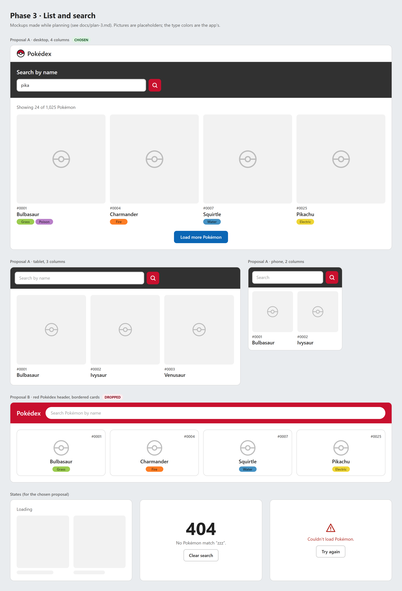

# Phase 3 plan: frontend, list and search

Goal: the Pokédex's main view. A responsive grid with each Pokémon's picture, number, name and types, search by name, a "Load more Pokémon" button and a 404 page when there are no results. The frontend only talks to our API (`/api`), never to PokeAPI.

## Decisions

| Topic        | Decision                                                                          | Why                                                                                                                                                              |
| ------------ | --------------------------------------------------------------------------------- | ---------------------------------------------------------------------------------------------------------------------------------------------------------------- |
| Design       | **Proposal A, classic** (see "Mockups")                                           | The closest to pokemon.com, the inspiration the challenge suggests. Plain and easy to read in dense grids                                                        |
| Loading more | **A "Load more Pokémon" button** instead of classic pagination or infinite scroll | It's what the official Pokédex does, and it's simpler than infinite scroll. **It changes the planning session's decision** (pagination with `?page=` in the URL) |
| Batch        | **24 Pokémon per click** (the official site uses 12)                              | 24 fills complete rows in 2, 3, 4 and 6 columns                                                                                                                  |
| Search       | **While typing, with a 300 ms debounce**, by name only                            | It feels immediate without overloading the backend. The challenge asks for search by name; search by number goes to "what I'd do with more time"                 |
| API types    | **Imported from the backend** through `api/types.ts`                              | A single source of truth for the contract. Verified: `tsc -b`, `vite build` and oxlint accept the import                                                         |
| Tests        | **Vitest + React Testing Library + jsdom**, with a mocked `fetch`                 | Same as phases 1 and 2: the tests are written in the phase                                                                                                       |

## Reference: the official Pokédex (reviewed on October 17, 2026)

At https://www.pokemon.com/us/pokedex:

- **Search:** "Name or Number" inside a dark band above the grid, with a magnifier button.
- **Card:** the official artwork on a gray background, a four-digit number (`#0001`), the name, and the types as colored pills.
- **Grid:** 4 columns on desktop and **1 on phones**, with huge cards; the search takes up the whole first screen.
- **Loading:** 12 at first and **12 more per click** on "Load more Pokémon".
- **Button:** it's an `<a>` without `href`, which isn't good accessibility practice.
- **Type colors:** some have low contrast. For example, "Poison" is white text on lilac (`rgb(185, 127, 201)`).

What we take: the card structure, the prominent search and "Load more". What we correct: **2 columns on phones**, a real `<button>` and pills with WCAG AA contrast.

## Mockups



- **Proposal A (chosen):** desktop (4 columns), tablet (3) and phone (2).
- **Proposal B (dropped):** a red Pokédex header with the search inside it (pill-shaped), and bordered, centered cards with the number at the top right. More "on brand", but it strays from the reference the challenge suggests.
- **States:** loading, no results (the 404 page) and error.

The image comes from [mockups/phase-3-list.html](mockups/phase-3-list.html).

## Behavior

### Loading more

- TanStack Query's `useInfiniteQuery` with the key `['pokemon', search]`. It requests `GET /api/pokemon?search=&page=N&limit=24` and accumulates the pages.
- **The backend doesn't change:** each click requests the next page.
- `getNextPageParam`: there are more pages while `page * limit < total`.
- The "Showing X of Y Pokémon" counter updates with each batch.
- While the next batch loads, the button shows "Loading…" and is disabled.
- Once all of them are loaded, the button disappears.
- **The URL only keeps the search** (`?search=pika`). Reloading the page goes back to the first batch, same as the official site.

### Search

- The text is written to the URL (`?search=`) 300 ms after the user stops typing, with `replace` so the history doesn't fill up.
- Changing the search resets the list to the first batch (it's a different query key).
- Enter in the field searches right away, without waiting for the debounce.

### No results and unknown routes

- If the search responds `total: 0`, **the 404 page** the challenge asks for is shown: a big "404", "No Pokémon match …" and a "Clear search" button. **The search box stays visible**, so the user doesn't get stuck.
- An unknown route (for example, `/abc`) uses the same 404 page.

### Error

If the API fails (for example, if the backend isn't running): the message "Couldn't load Pokémon" and a "Try again" button that retries the query.

## Responsive

CSS Grid with explicit breakpoints, so the columns match the batches of 24:

| Width       | Device            | Columns                                                               |
| ----------- | ----------------- | --------------------------------------------------------------------- |
| < 600 px    | Phone             | 2                                                                     |
| 600–899 px  | Tablet            | 3                                                                     |
| 900–1279 px | Laptop or monitor | 4                                                                     |
| ≥ 1280 px   | Large screen      | 6, with a maximum content width so the cards don't grow without limit |

## Accessibility

- A visible `label` for the search box ("Search by name").
- Pictures with an `alt` equal to the name, `loading="lazy"` and fixed `width`/`height` so the page doesn't "jump" while they load.
- The result counter with `aria-live="polite"`, so a screen reader announces the changes.
- "Load more Pokémon" is a `<button>`, with `aria-busy` while loading.
- Everything keyboard navigable, with a visible focus.
- **Type colors:** the 18 types as CSS variables, taking the official Pokédex's colors but with dark text of the same hue to meet WCAG AA.

## Structure

```
frontend/
  vite.config.ts             → proxy: /api → http://localhost:3000
  src/
    main.tsx                 → QueryClientProvider + router
    api/
      types.ts               → re-exports the backend's types (the only coupling point)
      client.ts              → fetch to /api and error handling
      pokemon.ts             → listPokemon({ search, page, limit })
    hooks/
      usePokemonList.ts      → useInfiniteQuery
      useDebouncedValue.ts
    pages/
      PokedexPage.tsx        → search + grid + Load more + states
      NotFoundPage.tsx
    components/
      PokemonCard.tsx, TypeBadge.tsx, SearchBar.tsx  (each with its .module.css)
    styles/
      tokens.css             → type colors, spacing and breakpoints
```

`api/types.ts`:

```ts
// Single source of truth: the backend's response types.
export type {
  PokemonListItem,
  PokemonPage,
  PokemonDetail,
} from '../../../backend/src/pokemon/pokemon.types';
```

Something to watch in the future: the backend's type files must keep containing only types, with no code that runs.

**New dependencies:** `react-router` 8 and `@tanstack/react-query` 5. For the tests: `vitest`, `@testing-library/react`, `@testing-library/user-event` and `jsdom`.

## Tests

Vitest + React Testing Library + jsdom, with a mocked `fetch`:

- The page shows the cards with the name, number and types.
- "Load more Pokémon" adds the next batch and disappears once all are shown.
- A search with no results shows the 404, and "Clear search" goes back to the list.
- An API error shows "Try again", and the button retries.

## Out of this phase

- The favorite heart and the user's UUID (phase 4).
- The detail page, including making the cards links (phase 4).

## Documentation

- README: how the frontend looks and is used, and the Vite proxy.
- `AI_USAGE.md`: this phase's decisions, including the change from classic pagination to "Load more".
