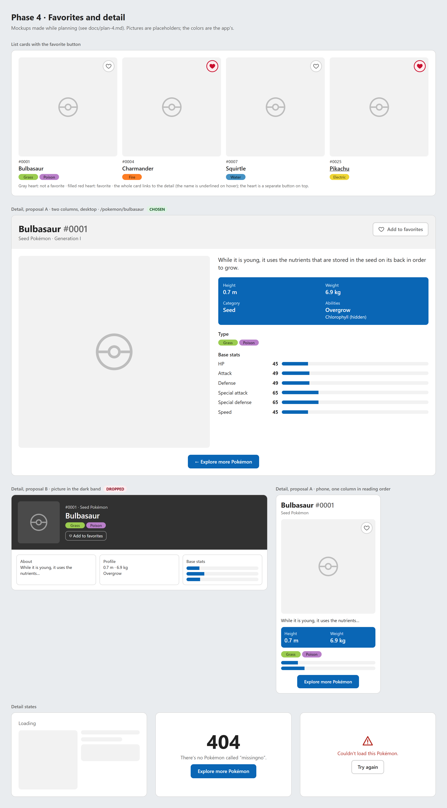

# Phase 4 plan: frontend, favorites and detail

Goal: mark and unmark favorites from the list and from the detail, and a detail page per Pokémon, reachable by its name in the URL (`/pokemon/bulbasaur`). Only the data the detail endpoint returns is shown. The backend doesn't change.

## Decisions

| Topic                  | Decision                                                                            | Why                                                                                                                                   |
| ---------------------- | ----------------------------------------------------------------------------------- | ------------------------------------------------------------------------------------------------------------------------------------- |
| Detail                 | **Proposal A, two columns** (see "Mockups"), on a separate page at `/pokemon/:name` | The closest to pokemon.com and the most consistent with the list: the same picture on a gray tile                                     |
| Data shown             | **Only what the detail endpoint returns**                                           | Evolutions, weaknesses, gender, cards and "previous/next" need data we don't have; they're left out                                   |
| Favorite               | **A heart on the card and a button with text on the detail**                        | The challenge allows marking it in the main view ("It can be the same main view"), and this way users don't have to open each Pokémon |
| "Explore more Pokémon" | **A fixed link to `/`**, the list from the start                                    | Same as pokemon.com. The browser's back button still returns to the list with the search, because it lives in the URL                 |
| Error when marking     | **It reverts and a short message appears**                                          | Without the message, the user would see the heart "unmark itself" without knowing why                                                 |

## Reference: the official detail page (reviewed on October 17, 2026)

At https://www.pokemon.com/us/pokedex/bulbasaur:

- A centered **title**: "Bulbasaur #0001", with "previous" and "next" above it.
- **Two columns:** on the left, the picture on a gray background with the stats below; on the right, the description, a blue box (height, weight, category, abilities, gender), the types and the weaknesses.
- **Stats:** vertical bars of 15 segments, **with no numeric value**; neither a person nor a screen reader can read them precisely.
- **Phone:** a single column, with the stats **before** the description.
- **"Explore More Pokémon":** a link to `/us/pokedex`, at the bottom of the page.

What we take: the two-column structure, the title with the number and the info box. What we correct: stats with their number and horizontal bars, and on phones the reading order (description before stats).

## Mockups



- **List cards:** a gray heart when it isn't a favorite and a filled red one when it is. The whole card links to the detail; the heart is a separate button on top.
- **Detail, proposal A (chosen):** two columns on desktop, and one column in reading order on phones.
- **Detail, proposal B (dropped):** the picture, name, types and favorite inside a dark band (like the search band), and below it three cards: About, Profile and Base stats. More compact, but with a smaller picture and less similar to the reference.
- **Detail states:** loading, not found (404) and error.

The image comes from [mockups/phase-4-favorites-and-detail.html](mockups/phase-4-favorites-and-detail.html).

## Behavior

### Detail page

- The `/pokemon/:name` route, with `useQuery` and the key `['pokemon-detail', name]` over `GET /api/pokemon/:name`.
- **Content:** number, name, category (`genus`), generation in Roman numerals ("Generation I"), a "Legendary" or "Mythical" badge when it applies, the description, height in metres and weight in kilograms, abilities with the hidden one marked ("Chlorophyll (hidden)"), types and the 6 stats.
- **Ability format:** the slug is shown readable ("lightning-rod" → "Lightning Rod").
- **Stats:** each one with its number and a horizontal bar on a 0–255 scale (the real maximum in the data).
- **Tab title:** "Bulbasaur | Pokédex", with `<title>` inside the component (React 19).
- **Navigation:** when entering the detail, the page starts at the top.
- **States:** a skeleton while loading; if the API responds `404`, the 404 page ("There's no Pokémon called "missingno".") with "Explore more Pokémon"; any other error, "Couldn't load this Pokémon" with "Try again".
- **"Explore more Pokémon":** a link to `/`, at the bottom of the page.

### Cards as links

The whole card leads to the detail through a "stretched" link over the name: the link covers the whole card with a pseudo-element. The heart stays on top, as an independent button: a button inside a link isn't valid HTML and confuses screen readers.

### Favorites

- **User:** a random UUID stored in `localStorage` under the key `pokedex.userId`. See "Anonymous user" below.
- **Header:** every request to `/api` carries `X-User-Id`, so the list and the detail already return the real `isFavorite`.
- **Button:** `<button aria-pressed>` with the label "Add Pikachu to favorites" or "Remove Pikachu from favorites". On the card it's only the heart; on the detail, heart and text.
- **Request:** `PUT /api/favorites/:id` to mark and `DELETE` to unmark; the client sends the state it wants.
- **Optimistic update:** the heart changes right away in **every** cached view (each loaded search and the detail).
- **Guaranteed order:** mutations for the same Pokémon run in series (`scope: { id: 'favorite-25' }`), so a double click can't leave the UI and the server out of sync.
- **If it fails:** the change reverts and a short message appears at the bottom of the screen ("Couldn't update Pikachu. Try again."), announced to screen readers (`aria-live`).
- **When it finishes:** the queries are marked stale without refetching them right then (`invalidateQueries` with `refetchType: 'none'`); they refresh the next time they're shown. That way a click doesn't reload every open "Load more" page.

### Anonymous user

**When it's created:** on the first request to the API, not when the app loads. The client (`api/client.ts`) calls `getUserId()` before each `fetch` to set the header:

1. **The first visit:** there's no ID in `localStorage`; one is generated, stored and sent.
2. **Following requests and reloads:** the stored one is reused, so favorites persist between visits in the same browser.

**Rules of `getUserId()`** (`lib/userId.ts`):

- **It validates the format** of the stored value: if it isn't a UUID (for example, because someone edited it by hand), it generates a new one. Otherwise the backend would respond `400` to every request and the app would be broken.
- **It reads `localStorage` on every call,** without keeping it in a variable: it's a very cheap read, a manual change of the value takes effect right away, and the tests don't depend on hidden state.
- **In-memory fallback:** if `localStorage` throws an error (some private modes or blocked storage), it uses an in-memory ID that lasts until the page reloads. In that case the favorites "disappear" on reload, the expected limitation without storage.
- **UUID generation:** `crypto.randomUUID()` only exists in secure contexts (HTTPS or `localhost`). If the app is opened by its local IP (for example, from a phone at `http://192.168.x.x:5173`), it isn't available. In that case a version 4 UUID is generated with `crypto.getRandomValues()`, which works in any context: 16 random bytes with the version (4) and variant bits set.

**How to switch users by hand** (for testing):

- **DevTools → Application → Local Storage → `http://localhost:5173`:** deleting the `pokedex.userId` key and reloading turns the browser into a new user, with no favorites. Putting the previous value back and reloading brings the favorites back.
- **From the console:** `localStorage.setItem('pokedex.userId', crypto.randomUUID()); location.reload();`
- **Another private window or another browser:** each has its own `localStorage`, so it's another user. It's the quickest way to check that one user's favorites aren't seen by another.

## Responsive

| Width    | Detail                                                                                          |
| -------- | ----------------------------------------------------------------------------------------------- |
| < 900 px | One column: title, picture (with the heart), description, info, types, stats and "Explore more" |
| ≥ 900 px | Two columns: picture on the left; description, info, types and stats on the right               |

## Accessibility

- The favorite button with `aria-pressed` and a label that names the Pokémon, on the card and on the detail.
- The stats show the number as text; the bar is decorative.
- The error message in an `aria-live` region.
- Keyboard navigable: on the card, the link and the heart are two separate tab stops.

## Structure

```
frontend/src/
  lib/userId.ts                → gets or creates the user's UUID (with the fallbacks)
  lib/userId.test.ts
  api/client.ts                → adds X-User-Id; apiGet and an apiSend for PUT and DELETE
  api/pokemon.ts               → getPokemon(name)
  api/favorites.ts             → setFavorite(pokemonId, isFavorite)
  hooks/usePokemonDetail.ts    → the detail's useQuery
  hooks/useToggleFavorite.ts   → optimistic useMutation, in series and with rollback
  components/FavoriteButton.tsx (+ .module.css)
  components/Toast.tsx (+ .module.css)   → the error message
  components/PokemonCard.tsx   → link to the detail and the heart
  pages/PokemonDetailPage.tsx (+ .module.css)
  App.tsx                      → the /pokemon/:name route and the message region
```

## Tests

**Anonymous user** (`lib/userId.test.ts`):

- Generates a UUID and stores it when there is none.
- Reuses the existing one.
- Replaces a stored value that isn't a UUID.
- Uses the in-memory fallback when `localStorage` throws an error (simulated with `vi.spyOn(Storage.prototype, 'getItem')`), and returns the same ID on consecutive calls.
- Generates a valid version 4 UUID with `crypto.getRandomValues()` when `crypto.randomUUID` doesn't exist.

**App:**

- Every API request carries the `X-User-Id` header with the same UUID.
- The heart changes right away and sends `PUT` or `DELETE` with `X-User-Id`.
- If the API fails, the heart reverts and the message appears.
- The detail page shows its data (number, category, hidden ability, stats).
- A nonexistent name shows the 404.
- The card leads to the detail, and "Explore more Pokémon" returns to the list.

## Out of this phase

- "Previous" and "next" on the detail.
- Evolutions, weaknesses, gender and trading cards.
- A favorites view or filter (the backend has no `GET /api/favorites`).
- Showing the offline state (decided in phase 3: left as is).

## Documentation

- README: the detail, the favorites and the user's UUID.
- `AI_USAGE.md`: this phase's decisions.
